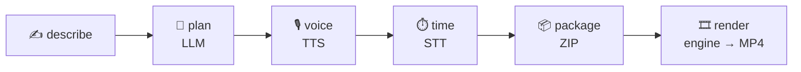

<div align="center">

<picture>
  <source media="(prefers-color-scheme: dark)" srcset="Documentation/Assets/logo-dark.svg">
  
</picture>

# 🎞️ Cratis Montage

**Describe a video. Get a video.** Story, self-hosted voiceover, animated infographics and cuts that land in the pauses — from one prompt, with not a single keyframe.

[](https://discord.gg/kt4AMpV8WV)
[](https://hub.docker.com/r/cratis/montage)
[](https://github.com/Cratis/Montage/actions/workflows/build.yml)
[](https://github.com/Cratis/Montage/actions/workflows/publish.yml)
[](LICENSE)

</div>

---

In film, a **montage** is the sequence where editing does the storytelling: images and sound cut
together so the rhythm carries the meaning. Montage does that editing for you. You write what the
video should say; an AI plans the story, speaks it, aligns every word to the voice, packages the
result and renders an MP4 deterministically.

Built on the Cratis stack: **Arc** (commands, queries, vertical slices), **Chronicle** (event
sourcing over MongoDB) and **Cratis Components** for the editor UI. The render engine itself is
deliberately standalone — a plain TypeScript package with zero Cratis dependencies, consumable by
anything that can serve a folder of files.

## 🎬 Why "Montage"?

- **Editing is the craft.** The best cuts sit on the breath before a line, not on a timer. Montage
  derives every cut from the word timings of the voiceover.
- **It is a sequence, not a pile.** Each stage — plan, voice, time, package, render — is an event, and
  the finished video is what they add up to.
- **It joins the Cratis storytelling family.** **Screenplay** writes the script, **Stage** performs it,
  **Chronicle** records what happened, **Direct** keeps the production moving — and **Montage** cuts it
  into the finished picture.

## ✨ From prompt to picture



## 🐳 Run it from Docker Hub

```shell
docker run -p 8080:8080 -v montage-data:/data/workspace \
  -e Cratis__MongoDB__Server="mongodb://host.docker.internal:27017/?directConnection=true" \
  -e Cratis__Montage__Ai__Endpoint="http://host.docker.internal:11434/v1" \
  cratis/montage
```

The image contains the editor, the render engine, Node, ffmpeg and Chromium. MongoDB, a Chronicle
kernel and your TTS / STT / language-model endpoints stay outside it and are configured through the
`Cratis__Montage__*` environment variables (the same keys as under `Cratis:Montage` in
`appsettings.json`). Mount `/data/workspace` to keep shows, packages and rendered videos.

## 🧩 The three parts

```
Source/Engine/          montage-engine — deterministic Canvas2D render engine (pure TS)
Source/Montage/          the editor: C# Arc backend + Chronicle + React frontend
Source/Composition/     Aspire AppHost — one command runs all of it
docker/mock-services.mjs  canned LLM/TTS/STT for wiring tests without AI services
```

### `engine/` — the render engine

Scenes are **pure functions of time**: same `t` in, same pixels out. That is what makes
the browser preview, the scrubber and the exported MP4 identical, and what makes edits
cheap — change a parameter, not a timeline.

- `show.json` spec: scenes with type, literal windows, transitions, captions, brand
- Scene library: `title`, `kinetic` (karaoke narration), `statement`, `steps`,
  `compare`, `flow`, `metric`, `chart`, `quote`, `code`, `endcard`
- Transitions: `cut`, `crossfade`, `wipe`, `slide`, `zoom`, `rise`
- Cratis dark theme: near-black grounds, warm off-white ink, violet accent, hairline
  rules, dot-grid canvas, Inter / Space Grotesk / JetBrains Mono
- Word-timed lyrics drive cuts and karaoke; a voice envelope drives subtle life
- Offline renderer: headless Chrome captures frames, ffmpeg encodes (stills, contact
  sheets and video)

```bash
cd Source/Engine
npm install && npm run build
node scripts/render.ts video --pkg demo --out out/demo.mp4   # the bundled demo show
node scripts/render.ts stills --pkg demo --t 1,8,16          # frames as PNG
```

### `Source/Montage/` — the editor

An Arc application with one vertical slice per pipeline stage. Every stage is an event;
every failure is an event; every stage can be re-run from the editor.

| Slice | Does |
|---|---|
| `Shows/Creation` | `CreateShow` — the one prompt, plus optional title/length/tone/audience |
| `Shows/Planning` | Reactor: asks the language model for story + script + scene specs |
| `Shows/Voiceover` | Reactor: synthesizes each scene's narration (OpenAI-compatible TTS) |
| `Shows/Timing` | Reactor: word-level alignment (faster-whisper) + loudness envelope |
| `Shows/Packaging` | Reactor: derives scene windows from the word timings, writes `show.json`, zips the package |
| `Shows/Rendering` | Reactor: drives the engine's renderer, records the finished MP4 |
| `Shows/Listing` | Projection: the live read model the editor observes |

The package (ZIP) is the durable artifact — spec, voiceover and timing data — that the
engine consumes as plain files. MP4s land on disk next to it.

The frontend lives in `Source/Montage/.frontend/` — React + `@cratis/arc.react` +
`@cratis/components` (PrimeReact), Cratis dark theme, live pipeline progress over
observable queries.

### `Source/Composition/` — Aspire

The AppHost wires the whole stack: a MongoDB 7 replica set (the way Chronicle needs it —
self-initiating, `directConnection=true`), the Chronicle kernel pinned to the same
version as the client package, the editor and the Vite frontend, with readiness gates so
nothing races the kernel. It is the one command:

```bash
dotnet run --project Source/Composition
```

The Aspire dashboard opens; the editor is on http://localhost:5000, the frontend dev
server on http://localhost:9000.

## 🚀 Getting started

Prerequisites: .NET 10 SDK, Docker, Node, ffmpeg, and a Chromium/Chrome for the engine
renderer.

```bash
# 1. The engine (one-time build so the preview player is served by the editor)
cd Source/Engine && npm install && npm run build && cd ../..

# 2. The frontend dependencies (one-time)
cd Source/Montage/.frontend && npm install && cd ../../..

# 3. Everything up, dashboard included — MongoDB, Chronicle, TTS, STT, editor, frontend
dotnet run --project Source/Composition

# 4. Describe a video and press "Plan & produce"
```

Without Aspire, `Source/docker-compose.yml` brings up the same infrastructure and speech
services (MongoDB replica set, Chronicle, Kokoro TTS on :8880, Speaches STT on :8770);
then run the editor itself with `cd Source/Montage && dotnet run`.

Point `Source/Montage/appsettings.local.json` (gitignored) at your self-hosted services —
they default to the ports the compose file and the AppHost already provide:

```jsonc
{
    "Cratis": {
        "Montage": {
            "Tts": { "Endpoint": "http://localhost:8880" },        // e.g. Kokoro-FastAPI (/v1/audio/speech)
            "Stt": { "Endpoint": "http://localhost:8770" },        // e.g. Speaches / faster-whisper (/v1/audio/transcriptions)
            "Ai": {
                "Kind": "OpenAICompatible",                        // or "Anthropic"
                "Endpoint": "http://localhost:11434/v1",           // Ollama, LM Studio, vLLM, OpenRouter, OpenAI
                "ModelName": "qwen2.5:14b"
            }
        }
    }
}
```

No services configured? The pipeline still works end to end for wiring: planning fails
with a readable error, the editor shows it, and any stage can be retried once a service
is available. For a full dry run without any services at all, run the mock services and
point the three endpoints in `appsettings.local.json` at `http://localhost:8790`:

```bash
node docker/mock-services.mjs        # canned plan + tone WAVs + word timings on :8790
```

## 🤖 What "automated" means here

- **Cuts sit in the pauses.** Every scene window is derived from the word timings: a cut
  lands in the breath before a scene's first word and holds through the pause after its
  last — like a picture editor cutting on breaths.
- **Spoken ≠ on-screen.** The planner writes narration and on-screen text separately;
  the engine renders only concise labels, claims and numbers.
- **Everything is re-runnable.** Regenerate the plan, the voice, the timing, the package
  or just the render — downstream stages follow.
- **Nothing is lost.** The show is event-sourced; the package is a ZIP; renders are files.

## 🎥 Render quality

60 fps, 1920×1080, x264 CRF 18 (configurable), BT.709 tagged, voiceover muxed in.
A 60-second show renders in roughly 2–3 minutes on an Apple Silicon laptop.

## 🤝 Community and license

Learn more at [cratis.io](https://www.cratis.io) or join the community on
[Discord](https://discord.gg/kt4AMpV8WV). Montage is released under the [MIT license](LICENSE).
